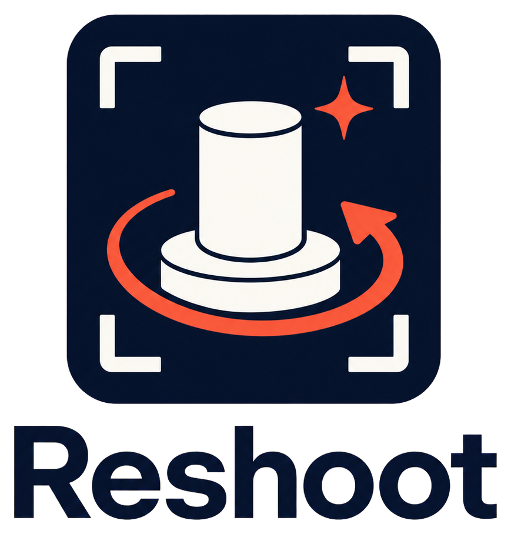
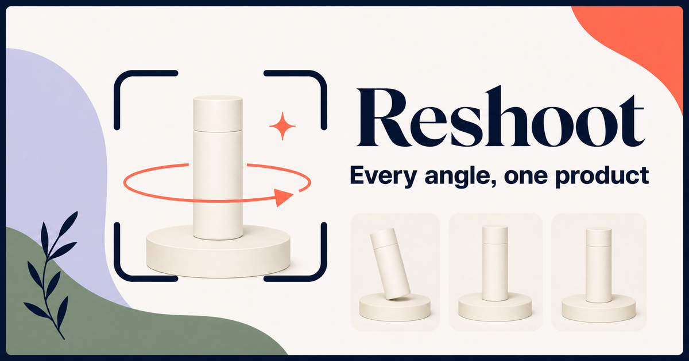

  
   
  <!-- repo-tagline:start -->
  <strong>📸 Every angle, one product 📸</strong>
  <!-- repo-tagline:end -->

  

Reshoot turns product photos into a consistent set of studio views. It helps
small brands and studios show a product from multiple angles.

## Try it

Open [Reshoot](https://reshoot.tsilva.eu) to preview sample rotations without
signing in. Use **Show original** to compare the everyday photo with the
studio views.

To make your own shoot, sign in and choose **Add photos**. Upload clear JPG,
PNG, or WebP reference photos, then review the generation cost before starting.
A completed shoot opens as a downloadable gallery. Hidden surfaces are
estimated from the supplied photos.

- [Studio reference](docs/studio-reference.md) covers uploads, generation, and
  local setup.
- [Image generation evaluation](docs/image-generation-evaluation.md) explains
  the photo and rotation checks.
- [Testing](docs/testing.md) and [production delivery](docs/production-delivery.md)
  cover deployment and service configuration.

## License

[MIT License](LICENSE).
