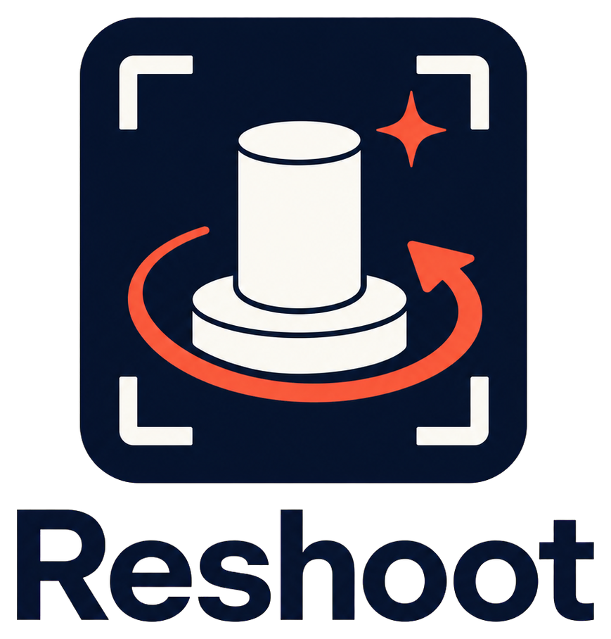
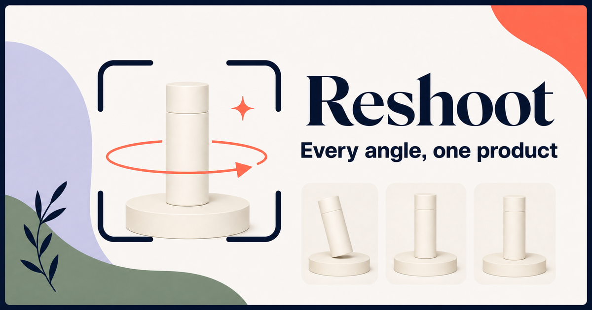

<p align="center">
  
  <br />
  <!-- repo-tagline:start -->
  <strong>📸 Every angle, one product 📸</strong>
  <!-- repo-tagline:end -->
</p>

<p align="center">
  
</p>

Reshoot is a product-photography studio for small brands, studios, and product teams. Explore free, pre-made samples on the home page, add reference photos, and get studio views automatically. A completed shoot opens as a gallery with one large photo. The top bar holds the shoot title, back link, rotation controls, and Download. Reference photos and the Generate button appear only before the shoot’s first generation. Saved shoots appear as clickable photo-and-title cards, without photo counts, separate open/delete buttons, search or a second new-shoot button; Add photos in the introduction starts a shoot. The borderless cards show the latest generated front view, or the primary reference photo while a front view is unavailable. While a shoot is generating, its card shows Generating with a progress bar underneath. The bar follows completed and failed batch jobs through live updates; it stays indeterminate until progress is available. Finished cards refresh automatically. The whole card opens its shoot and grows slightly on hover, with animation disabled for reduced-motion preferences. The library stays visible while a shoot opens. The gallery starts at the top. Returning with the back arrow, Reshoot home link, or browser Back scrolls to the visited project's card, clear of the sticky header. If that project is no longer listed, the back arrow opens the library heading. The account panel includes Plan & usage: three monthly plans, an allowance summary, and credit activity. Studio is highlighted as Best value; Pro offers Most usage. The header balance shortcut and View plans button open this panel directly. Monthly allowances expire at the end of each paid billing period without rollover. Existing one-time credits retain their original non-expiring terms.

**Add photos** opens a blank shoot workspace. Set up the shoot there by choosing reference photos or dragging and dropping them onto the page; no name or separate upload dialog is required. The empty upload area fills the available height below the header. The lower Add photos and Generate controls appear only after a reference photo is saved, and disappear again when the last reference is removed. Photos upload directly into the shoot, with progress and retries for failed files. Once references are ready, the workspace calculates the price for eight studio views. Reshoot suggests a short name for the product in the first saved photo, leaving out the surroundings and how it is held or placed. On touch devices whose browser supports native capture, **Take a photo** opens the rear-facing camera; choosing existing photos remains available. File selection, drops, and camera capture use the same JPG/PNG/WebP validation and limits: up to 25 photos, 20 MB each, and 500 MB per shoot. Camera availability and the native chooser depend on the device/browser. If automatic naming is unavailable, photos are still saved under **Product shoot**. Later uploads preserve the shoot’s existing name.

New shoots use an upright display pose and rotate around a fixed vertical axis. Uploads supply the product’s appearance and details. Their camera tilt and pose do not carry over into the turntable. Every object uses the same physical direction frame and rotation guidance. Its original photographs determine shape, construction and materials; no object category selects a special scaffold or prompt.

On mobile, the shoot workspace stacks reference controls and Generate beneath the preview. Checkout dialogs fill the available screen, including short phone landscape layouts. Safe-area padding keeps dialog controls clear of screen cutouts and the home indicator; the page behind the dialog stays still. Desktop dialogs remain centered.

The home page introduces AI product photography with “Your photos. Professional 360° views.” Its primary action, “Add photos,” opens a blank shoot workspace. One short sentence explains that product photos become studio views automatically. The cleaned product stays dominant, with a small unframed original-photo thumbnail and a quiet “Show original” link at the lower right of the control row. Previous, play/pause, and next sit centered beneath the photograph, aligned with the original thumbnail. The generated medallion and product-selector row are removed.

The home page reserves space for the header, introduction, upload action, playback controls, original preview, and footer before sizing the product photo to the remaining viewport height. Phone and tablet layouts stack the introduction above the sample with tighter spacing. Very short screens and enlarged text retain natural scrolling so content stays readable and accessible. Scrollable pages and panels use a slim, rounded scrollbar in the studio’s muted palette; forced-color mode retains the browser’s accessible defaults.

The samples require no session and use no credits. On page load, the linen doll starts on its cleaned front view. Eight studio angles advance every 0.9 seconds; after the last angle, the slideshow switches to the next product’s front view, cycling through Linen doll, Ceramic mug, and Leather handbag. The original is never inserted into this automatic sequence. All twenty-four studio photographs preload and stay mounted. Previous/next and keyboard arrows move through the same sequence, including across product boundaries, and pause playback until Play is selected.

The original thumbnail stays small and unframed. On a pointer device, hovering it smoothly enlarges the photo upward from its bottom-right corner without shifting the page; keyboard focus offers the same preview, and reduced-motion preferences remove the animation. Clicking “Show original” pauses the slideshow and opens the full original photograph in the existing accessible dialog. The lightbox shows only the photograph, with minimally rounded corners and a soft shadow. A bordered, shadowed close button overlaps the photo’s top-left corner. An accessible name and image description identify the original and its illustrative nature; the dialog traps focus and closes through its close button or Escape. Closing returns focus to the thumbnail and restores the previous angle and playback setting. Touch users can open the dialog directly. No product-selector footer is shown.

Playback starts after the current product’s studio photos load, including while the mouse rests over the preview. Keyboard focus on a carousel control pauses it, as do an offscreen sample or hidden page. The pause/play control stops or resumes the loop immediately, including while keyboard focus remains on the button; a later keyboard focus can pause it again. Reduced-motion preferences disable automatic playback by default, with Play available as an explicit opt-in. Automatic changes do not announce every frame to screen readers; manual navigation still announces the product, photo and position.

Reshoot uses real Clerk sign-in and an account-owned workspace. Public samples remain available without signing in; adding photos, private shoots, and the wallet require an account. Saved shoots are listed at `/projects`, and each shoot opens at `/projects/<id>`. The “Your shoots” section appears only once at least one shoot exists; legacy browser-import checks do not display notices. New accounts start with zero credits. Open Plan & usage to select Starter ($15/month, 750 credits), Studio ($29/month, 3,000 credits), or Pro ($89/month, 8,000 credits). Only monthly plans are offered; there are no new top-ups or annual plans. The current integration remains Stripe test-only: no real money is charged. Older `/?project=<id>#studio` links redirect to the shoot’s new URL. A browser-proven legacy private shoot can be moved into the signed-in account, retaining its URL and images; the old account retains its credit history. Existing shared-demo records are preserved without being assigned to a new user.

The carousel’s accessible description identifies these as illustrative examples. Its everyday uploads were created from earlier product artwork, then edited to add cluttered household backgrounds, uneven indoor lighting, slight overall softness, and natural handheld framing. All three sample products’ photographs are generated from their displayed original as the authority for identity, materials and photographic detail, plus a textureless mesh capture used only to clarify orientation and occlusion. Final artwork comes from native image generation; rendered meshes and proxy textures are not published as product photographs. Hidden surfaces remain estimates, and these examples are not recorded customer uploads or measured results of the paid application pipeline. See [example upload provenance](design/qa/example-uploads/generation.json), the [current rotation record](design/qa/original-rotation/generation.json), and [original/guide input roles and exact prompts](design/qa/orientation-guided-rotation/photographs.json).

Each rotation cycles through front, front-right three-quarter, right profile, back-right three-quarter, back, back-left three-quarter, left profile, and front-left three-quarter. The doll turns as a whole, the mug’s handle passes behind and then in front of its body, and the handbag includes narrow side profiles and a plain rear panel. Hidden surfaces are conservative estimates from the single original. Lighting stays above camera-left, with soft shadows extending to screen right. Views switch at full opacity without a fade-in animation.

New generation requests ask for the product to turn around its own center vertical axis while the camera and studio lights stay fixed. They explicitly lock the camera’s position, distance, elevation, focal length and framing; all standard angle presets use the same level camera elevation. For shots with a defined angle, the app appends a server-rendered, textureless generic cup image at that exact azimuth/elevation as an orientation-only cue. The selected originals remain the only authority for the user's product identity, shape, materials and photographic detail; the prompt explicitly forbids copying the cup, handle, gray material or dimensions. This is a temporary generic cue, with product-specific mesh support deferred. These are generation targets, not a guarantee of rigid 3D reconstruction. Existing saved results are unchanged.

To create or replace sample artwork from an original photo, use the repository’s [$reshoot_generate-rotation-images](.codex/skills/reshoot_generate-rotation-images/SKILL.md) skill. It generates photographic outputs from the authoritative original with textureless mesh views as orientation hints, and separately reviews source fidelity, rotation coherence and registration. After authorized deployment, it verifies every view, playback and product transition in the actual live carousel on desktop and phone against the exact READY production commit, retaining visual evidence. A fixed proxy rig proves the hints are consistent; it does not prove the final AI photographs share rigid geometry. The earlier handbag dimension drift is preserved in the historical QA record; the current bag was regenerated with the same original-plus-guide method.

All 24 sample views use transparent images on the carousel’s white background. The cutouts retain the generated alpha and have no baked studio shadow.

Uniform display scaling and translation register each sample product’s body axis at the exact horizontal center and hold its base steady across its eight views, without cropping, stretching or retouching the generated artwork. Registration measures the doll’s torso, the mug’s base below its handle, and the handbag’s full body below its handles, rather than a moving side-panel seam. A measured envelope leaves at least 10% product margin on every edge; narrower profiles retain more white space. The soft shadow is excluded from the product silhouette. Registration values scale with the viewer on smaller screens. [Measured framing](design/qa/original-rotation/framing.json) records the bounds, and `pnpm test` verifies all 24 published images against their source hashes, display margins, centered axes and consistent floor contact.

The visual design retains the editorial typography, clay and olive accents, and fine rules inspired by [Mudora by RylicStudio](https://dribbble.com/shots/26596729-Mudora-Pottery-and-Ceramics-Landing-Page), on a white studio surface. Instrument Serif supplies the headlines and Hanken Grotesk the controls. The sample uses a single photo carousel; repeated marketing sections and the oversized empty-library illustration are removed. The Plan & usage tab, upload dialog, and saved shoots share the white design.

The first uploaded original is the identity anchor. The studio automatically includes up to four more ready originals in upload order, preserving an existing shoot’s saved anchor. Projects can still store 25 originals; when more than five are saved, the studio explains the generation limit. The studio plans eight views for each new shoot, one every 45° around the product. The **Generate** button shows the quoted credit total in smaller text below its label once reference photos are ready. Select a thumbnail to preview that reference in the large canvas; this does not change the generation anchor or cost. Remove photos using the X at the top left of each thumbnail, or add photos until satisfied with the cost. Every change invalidates the old quote and calculates a new one. More reference photos add context and can increase cost, up to the five-reference limit. Removing the primary photo promotes the next saved reference; removing every photo returns to the blank workspace. References are locked once generation starts. The drag overlay only identifies the drop target; pricing appears after photos are saved. Clicking it confirms the credit hold and starts generation. If a quote fails or expires, Generate refreshes the price for review before confirmation. Uploading more photos invalidates that quote; an expired quote must be checked again. The canvas initially shows the reference photo, then the latest version of the first completed view. The landing page’s previous, play/pause and next controls replace the output thumbnails. Generated views rotate every 0.9 seconds after their photos load. Manual navigation pauses playback. Left/right arrow keys also browse views. Playback follows the same reduced-motion, keyboard-focus, visibility and offscreen behavior as the landing page. A single completed view has disabled playback controls; a reference-only shoot has none. The gallery shows the latest version of each view. Generation prepares a ZIP of those images regardless of approval status. Download starts transferring the saved ZIP as soon as you click it. Archives are named `reshoot_<hyphenated-project-name>_<first-8-project-id-characters>.zip` and contain a folder with the same name (without `.zip`). Images inside use only their perspective label, such as `angle_N.png`, and retain their actual image format; repeated labels receive a numeric suffix to preserve every image. Older shoots prepare their ZIP the first time you reopen them. Each shoot supports one generation batch; regeneration and additional sets are unavailable. Quotes for existing shoots and legacy regeneration requests are rejected, and confirmation rechecks this rule under the credit-account lock before reserving credits. Replaying the same confirmation or resuming its existing batch remains safe. The header shows the credit balance beside the account avatar. The balance shortcut opens Plan & usage directly in the account panel, without scrolling away from the shoot. Confirmed monthly payments refresh that balance and the generation quote. Existing account and wallet links also open Plan & usage. Gallery autoplay rotates right by default, matching the Rotate right control. The gallery photo expands to use the desktop viewport while keeping playback controls above the fold. Before generation, the photo reserves room for references and Generate; phone controls wrap below the canvas without horizontal page overflow. The internal orientation cue is appended after those originals; it is not a selectable original or an extra customer reference in the quote. Each oriented output receives an independent visual check for the requested physical side, stable construction and consistent occlusion before acceptance. Wrong or uncertain views release held credits without automatic retries. Image generation and visual review record their provider costs separately. Genuine rotational symmetry may produce equivalent views; these checks do not establish coherent 3D geometry, so inspect the complete rotation for consistency.

## Install

```bash
git clone https://github.com/tsilva/reshoot.git
cd reshoot
pnpm install
pnpm secrets:check
pnpm dev --port auto
```

For direct browser storage requests such as uploads, the private R2 bucket's CORS policy must allow the server's printed origin, including its automatically assigned port, with `GET`, `PUT`, `HEAD`, and the `Content-Type` header. A bucket administrator can configure it using [Cloudflare's CORS guide](https://developers.cloudflare.com/r2/buckets/cors/). Direct storage requests use signed URLs. ZIP exports stream the original images through Reshoot's authenticated download route. Deleting a project immediately removes its current and legacy ZIPs from the bucket. A failed ZIP deletion leaves the project available for retry; an in-progress export cannot recreate a deleted project's ZIP. Original and generated image retention continues to follow the existing 30-day policy.

Development and Vercel Preview use the private `reshoot-development` bucket and
the Development database. Production keeps the private `reshoot` bucket and its
Production database. Each bucket has its own Object Read & Write token, with no
access to the other bucket. Fetch local credentials from the pinned Development
Infisical project; never copy Production credentials into local or Preview
configuration. See [R2 environment isolation](docs/production-delivery.md#r2-environments)
for the source vaults, rotation procedure, and rollback boundary.

## Authentication and Stripe test payments

The native Clerk/Vercel integration supplies environment-specific
`NEXT_PUBLIC_CLERK_PUBLISHABLE_KEY` and server-only `CLERK_SECRET_KEY` values to
Production and Preview. These two keys are an approved exception to the Infisical
source policy: keep them managed by Clerk and do not mirror them into secret sync. Sign-in is at
`/login`; sign-up is at `/sign-up`. Clerk user IDs, rather than email matching or
browser cookies, identify account ownership. Missing Clerk configuration leaves
public samples available and private access closed; it never restores the shared demo.
Production builds require both Clerk keys and fail if either is missing.
The SDK is not used to provision keyless applications.

Google sign-in uses the same Clerk account flow as email sign-in. Enable the
Google social connection in the matching Clerk instance; the existing sign-in
and sign-up components display it automatically. Google OAuth credentials belong
in Clerk, not in application environment variables. See
[Google sign-in configuration](docs/production-delivery.md#google-sign-in).

The public [privacy policy](https://reshoot.tsilva.eu/privacy) and
[terms of service](https://reshoot.tsilva.eu/terms) are available without an
account and linked from the home and authentication pages. Their source text is
maintained in `lib/legal.ts`. Review policy changes before publication and keep
Google OAuth's branding links aligned with these canonical URLs.

Apply the additive `0003_flimsy_joseph` migration through the authorized database
migration procedure before enabling sign-in. It adds a unique, nullable Clerk user
ID without changing existing users, projects, or balances. Apply additive migration `0004_monthly_subscriptions` before deploying the monthly-plan code. It adds subscription and paid-invoice records, monthly allowance fields, and per-generation funding attribution without modifying existing balances. Stripe owns recurring billing and customer subscription status; Reshoot stores a webhook-maintained projection and enforces usage in Neon. Only a verified `invoice.paid` for the configured monthly price grants an allowance, once per paid period. Checkout returns and subscription status events never mint credits. Failed renewal adds nothing; existing paid access lasts until its recorded expiry. Cancellation is managed through Stripe's portal at the end of the paid period.

`RESHOOT_PAYMENTS_MODE=stripe_test`, the sandbox key/signing secret, all three monthly Price IDs, and a suitable portal configuration are required before checkout is offered. Live keys, events, sessions and real-money accounts remain rejected. The previous top-up creation routes return 410; historical paid test sessions can still be fulfilled and inspected. See [Stripe test setup](docs/production-delivery.md#stripe-test-checkout) for configuration and activation boundaries.

The trusted Production delivery mapping supplies the public payment-mode setting
from the isolated Production Infisical vault, while preserving native Clerk keys.
Local application-service access still requires a separately reviewed credential
route; the existing migration-audit route is read-only and does not supply
application credentials. Do not bypass that boundary with raw secret injection.
Live payments and automatic recharges are unsupported; monthly subscriptions run in Stripe test mode only.

## Commands

```bash
pnpm dev        # start the local development server
pnpm build      # create a production build
pnpm start      # serve the production build
pnpm lint       # run ESLint
pnpm typecheck  # check TypeScript
pnpm test       # run unit and integration tests
pnpm db:check-migrations # inspect the Production ledger through Agent Vault
pnpm db:migrate # apply forward database migrations
```

Local builds skip Sentry source-map uploads. Runtime error reporting still uses the configured DSN.

For Codex release work, use [$reshoot_build-release](.codex/skills/reshoot_build-release/SKILL.md).
It follows the existing [production delivery](docs/production-delivery.md) workflow
and verifies the exact deployment commit and Production domain assignment.

### Read-only migration inspection

On a configured trusted Mac, `pnpm db:check-migrations` checks the Production
`main` branch of `reshoot-neon`, database `neondb`, through Agent Vault. It reads
only permission metadata and `drizzle.__drizzle_migrations`, requiring an exact
match with the checkout's migration timestamps and SQL hashes. It rejects access
to application tables, migration writes, elevated roles, role memberships,
database/schema creation and callable non-system security-definer functions.
An unconfigured route, authentication failure or ledger mismatch stops the check.
It does not apply migrations.

Provisioning requires a separate `reshoot_migration_auditor` PostgreSQL login
without role memberships, superuser, database/role creation, replication or RLS
bypass. Grant only database `CONNECT`, `USAGE` on schema `drizzle` and `SELECT` on
`drizzle.__drizzle_migrations`, and set its `default_transaction_read_only` to
`on`. Create the role through SQL: Neon console-created roles can inherit broader
permissions. Initialize its password through a trusted administrator, then copy
the complete connection URL directly from Neon into the Agent Vault service's
Token field. Never commit or pass that URL to the checker.

The reviewed bundle is `local-reshoot-migration-audit`, with one HTTP service,
`reshoot-neon-ledger`, restricted to `POST /sql` on the exact pooled Neon endpoint.
Its bearer credential uses header `Neon-Connection-String` and an empty prefix.
The checker sends a placeholder; Agent Vault replaces it with the stored URL.
The local proxy must already be running. A trusted administrator installs an
owner-only `~/.config/infisical/neon-migration-checks/reshoot.json` containing only
metadata: `version` (1), `project_id` (matching `.infisical.json`), `bundle`,
`host`, `database`, `role`, absolute `infisical` and `ca_file` paths, `proxy`
(`127.0.0.1:8283`) and the reviewed `ca_fingerprint` (`SHA256:…`).

The launcher pins the Infisical instance and proxy CA without changing system
trust. It runs curl in a macOS sandbox allowing only the local proxy and public
CA access from the home directory. The trusted launcher manages the session;
the SQL client receives a placeholder and short-lived proxy-session credentials.
This protects the SQL client, not full-access processes elsewhere on the host.
The shared token broker is unnecessary for this static Neon credential. Test a
new route with synthetic credentials before a bounded authenticated check.

## Provider cost accounting

Apply additive migration `0005_provider_cost_tracking` before deploying provider
cost tracking. Every application image-generation and automatic shoot-naming
request creates a `provider_calls` record before contacting the provider. If the
record cannot be saved, inference is not sent. Records retain the actual gateway,
routed/requested model, reported model/provider when available, both request and
response IDs, HTTP outcome, timestamps, and provider-reported USD cost in micros.
They never store credentials, prompts, response bodies or image payloads.

New rotation verification also records its vision-review
requests separately. Apply `0006_rotation_review` before deploying that path;
see [rotation acceptance and its limits](docs/image-generation-evaluation.md#upright-rotation-in-user-generation).

Usage is committed before decoding or validating images, writing storage, or
settling customer credits. Rejected images and failed requests can still incur
provider costs. Missing, null, invalid or negative costs remain unresolved;
they never become zero. An explicit provider-reported zero is valid. Missing
OpenRouter costs with a generation ID get one bounded read-only metadata lookup
through the same hosted provider account. Operator reconciliation can retry
metadata lookups without generating anything. AgentBridge credentials are never
sent to OpenRouter history endpoints. Unsupported or unavailable history stays
unresolved, including timeouts without a recoverable ID.

Operator-only `GET /api/internal/provider-costs?projectId=<uuid>` reports the
recorded subtotal, unresolved/pending counts, per-call details and durations.
`totalCostMicros` is null until all recorded calls are finished and priced; an
empty ledger also has no certified total. The scope is recorded provider calls,
not infrastructure cost or customer credit value. `POST` to the same URL retries
at most 25 eligible metadata checks, throttled to once per minute per record.
Both methods require the existing `CRON_SECRET` bearer authorization in every
environment and disable response caching. This endpoint never changes pricing,
credits or subscriptions, dispatches generation, or runs retention cleanup.
No schedule is enabled by this change. Ordinary agent access still needs a
reviewed sandboxed service route; do not retrieve the bearer secret directly.

The migration preserves previously recorded positive image costs. Historical
zero amounts are unresolved because older code could coerce invalid usage to
zero. Historical requests without recoverable IDs and pre-migration naming
spend cannot be reconstructed reliably. Recorded-call totals do not certify
complete historical project spend. Elapsed durations include response transfer
and parsing, not just model inference; interrupted records can lack a finish time.


## Notes

Sentry 11 uses the `@sentry/nextjs/config` build entry point and enables logs by default. Client and server integrations retain their configured log levels and explicitly disable personal, request, queue, and content data collection.
Dependency regression tests accept newer patched versions within reviewed release branches, reject vulnerable downgrades and unknown branches, and audit the complete locked graph.
The CI baseline includes Next.js 16.4.2, Vitest 4.1.12, Vite 8.2.4 and Zod 4.6.7; the seven-day package-age rule and vulnerability audit remain enabled. Failed CI holds Production delivery before credential sync or deployment.

The approved October 31, 2026 security exception pins `minimatch` 11.0.1, `glob` 14.0.2, `@isaacs/nonrecursive-glob-match` 1.0.1 and `path-scurry` 3.0.0. pnpm 10.17 needs name-based age exclusions, so exact overrides restrict those exclusions to the approved releases. A small CommonJS export patch routes legacy callable `minimatch` imports and modern named imports to the same patched matcher. Regression checks cover ordinary matching, bounded globstar preprocessing and cancellation before/during directory traversal; the complete dependency audit remains enforced.

- Neon stores users, projects, immutable generation history, pricing, and credit accounting.
- Active generation batches use Neon Realtime instead of the previous two-second status poll. The private subscription carries only a batch revision; changes coalesce into a status read, and outputs are limited to that batch. Connections pause in hidden tabs and close when the batch finishes. Reconnect resumes a saved batch without creating another credit hold.
- A private Cloudflare R2 bucket stores originals, normalized references, previews, and generated outputs. Browser uploads use short-lived signed URLs.
- Scheduled reconciliation is disabled. Users request another attempt with Regenerate after a failed generation; automatic pricing reconciliation and expired-object cleanup are also paused.
- Each active batch has a durable workflow for outbox dispatch retries and stalled-attempt credit release, independent of an open browser. It sleeps until dispatch/lease deadlines; it never automatically repeats a paid image request. Status GETs and subscription renewals have no generation side effects.
- Dependency overrides exclude Workflow's unused NestJS adapter and use tinyglobby for Next.js lint root discovery, removing two unpatched dependency chains while retaining Next.js Workflow support and lint rules.
- Uploads accept up to 25 JPG, PNG, or WebP originals per project, 20 MB each and 500 MB total.
- Clerk verifies identity; Stripe owns billing and subscription state. Neon stores the local subscription projection, immutable monthly invoice receipts, and the credit ledger. Verified webhooks grant each paid month once. Monthly credits are spent before legacy credits, expire at their paid-period boundary, and cannot be revived by a late generation refund. Existing held generations can finish across renewal. No per-generation Stripe request is needed. Test credits still authorize real image-service requests; generation consumes provider resources.
- The image service and model are private server configuration and are intentionally absent from public APIs, browser bundles, filenames, and customer-facing diagnostics.
- Account workspaces skip automatic imports from the legacy browser database. Existing shared-demo and legacy credit records remain unchanged.
- The deployment target is the Vercel project `tsilvas-projects/reshoot` at `reshoot.tsilva.eu`.
- The preserved Stitch export is in [`design/stitch-source`](./design/stitch-source). See [testing guidance](docs/testing.md) for repeatable UI and rotation checks.

## Image generation evaluation

The current catalog-photo prompt defines camera movement and preserves product packaging and markings. Local and web generation request transparent output by default. The white studio surface shows through in the gallery, and the downloaded image retains its alpha channel. The shared prompt calls for neutral camera-left lighting and at least 10% clear margin on each side, with a fixed scale and body anchor across views. Reshoot releases the held credits if the provider returns an opaque or blank image. Flare is the selected default; Sunburst remains a server-configured alternative. See the [model comparison and reproduction procedure](./docs/image-generation-evaluation.md). Hidden surfaces are estimates unless supporting originals show them.

## Model routing

Development uses AgentBridge (`AGENTBRIDGE_BASE_URL`, default
`http://127.0.0.1:8082/api/v1`, and optional `AGENTBRIDGE_API_KEY`).
Production and Preview call OpenRouter directly using their own server-only
`OPENROUTER_API_KEY`; a missing production key disables model requests.
Production credentials come from this app’s isolated Infisical project.
The shared text-routing default is `deepseek/deepseek-v4.1-flash-1017`.
Image generation keeps the supported image models.

Automatic shoot naming uses the vision-capable [`openai/gpt-4.1-mini`](https://openrouter.ai/openai/gpt-4.1-mini) through the same environment-specific provider routing. It sends only the first validated 640px preview inline, without filenames, owner details, EXIF metadata, or signed storage URLs. One naming attempt has an eight-second timeout and an 80-token output cap; it creates no image-generation jobs or credit holds. The title update is conditional on the original placeholder and primary photo, so a concurrent rename or primary-photo change wins.

Production secrets are delivered through the pinned shared GitHub Actions workflow. The standalone signed Infisical relay triggers synchronization and deployment; see [production delivery](docs/production-delivery.md) for scope and recovery.

Production delivery keeps Vercel secret isolation enabled and distinguishes public configuration from private credentials; see [production delivery](docs/production-delivery.md).

## Live generation updates

Apply `pnpm db:migrate` through the environment's existing credential workflow before running this version. Migration `0002_generation_realtime` adds an owner-scoped revision table and transactional triggers, including rows for existing batches. The Realtime beta cannot subscribe to the custom enum types in the generation tables, so the subscription reads only built-in UUID and bigint columns.

Enable Realtime on the matching Neon branch and keep `NEON_REALTIME_URL` and the server-only `NEON_REALTIME_SECRET` in that environment's Infisical vault. The local launcher injects both in memory. The server derives the database name from `DATABASE_URL` and seals a short-lived query using the authenticated workspace owner and requested batch; browsers cannot choose another owner or alter that query. Capabilities renew about every 50 seconds without loading generation history. Missing configuration displays a Reconnect action and does not restore interval polling.

Realtime reduces repeated unchanged result transfers; actual savings depend on batch activity and concurrent viewers. Neon still bills normal database compute and egress during its Realtime beta. A disconnected or backgrounded browser does not stop durable generation or credit settlement.

`pnpm test` covers subscription coalescing, renewal and authorization failure, durable dispatch/lease maintenance, and the guard against paying for an attempt that already ended. The opt-in `tests/batch-realtime-db.test.ts` contract test requires an explicitly disposable Neon branch; it creates database-only fixtures and never requests images or mints credits.

## License

[MIT License](LICENSE).
