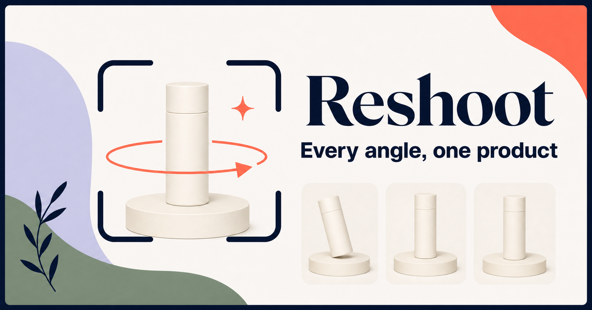

<p align="center">
  
  <br />
  <!-- repo-tagline:start -->
  <strong>📸 Every angle, one product 📸</strong>
  <!-- repo-tagline:end -->
</p>

Reshoot is a single-page product-photography studio for small brands, studios, and product teams. Explore free, pre-made samples on the home page, upload your own product, choose the views you need, and keep every generated version and approval together. Opening a saved or newly uploaded shoot replaces the sample canvas, and the wallet expands on the same page for balances, credit activity, and supported test top-ups.

The home page introduces AI product photography with “One product photo. Every angle.” Its primary action, “Upload your product photo,” opens the photo-upload dialog. Left/right carousel controls cycle through the sample views, including keyboard arrow navigation; matching silver-and-ivory medallion badges distinguish the original front photo (camera) from the generated views (sparkle). Their labels remain live text, and both lightweight transparent emblems load eagerly so changing views also switches the badge immediately.

The samples require no session and use no credits. Choose Linen doll, Ceramic mug, or Leather handbag using the thumbnail image buttons below the viewer. The selected thumbnail has a contrasting border; product names remain available to screen readers and in hover tooltips. Each product has eight views; changing products returns to its source photo and pauses rotation until Play is selected. All twenty-four product photographs preload and stay mounted, so switching products uses images already fetched. Starting your own shoot or opening a wallet creates or resumes the private browser workspace. Older welcome, project, and account links return to the home studio; a selected shoot remains addressable through `/?project=<id>#studio`. Real billing remains disabled, and no-charge test top-ups remain limited to local and Preview environments.

The selected product rotates automatically through its eight views every 0.9 seconds after its photos load. Moving the mouse into the carousel or focusing a carousel control pauses it, as do an offscreen sample or hidden page. The pause/play control stops or resumes the loop immediately, including while the pointer or keyboard focus remains on the button; a later mouse entry or control focus can pause it again. Using previous/next or arrow keys pauses it until Play is selected. Reduced-motion preferences disable automatic playback by default, with Play available as an explicit opt-in. Automatic changes do not announce every frame to screen readers; manual navigation still announces the photo and position.

The sample’s eight full-size linen-doll photographs share a fixed camera, lighting setup, and scale. The carousel cycles through front, front-right three-quarter, right profile, back-right three-quarter, back, back-left three-quarter, left profile, and front-left three-quarter. The additional left and rear views are imagegen edits with matching camera-left lighting and rightward floor shadows. All eight responsive images are preloaded in the initial page response and stay mounted, so browsing views can use photos already fetched. Views switch at full opacity without a fade-in animation. The original four backgrounds were independently changed to white; each pair of additional views was edited independently using approved photographs as geometry and lighting references. The viewer fits the complete doll without cropping and softly fades the outer background edges into the white page. See the [left-view prompts](design/qa/rotation-lighting/generation.json) and [rear-view prompts](design/qa/rotation-lighting/rear-generation.json) with their source references.

The ceramic mug adds eight independently edited photographs from one fixed source frame, keeping the cobalt glaze, handle design, camera-left illumination, and rightward shadows consistent. The handle passes behind the body and then toward the camera through a complete rotation. Per-frame display offsets register the mug’s foot to one fixed point, keeping its body anchored as the handle changes sides; percentage offsets preserve alignment on smaller screens. Source artwork, exact prompts, and asset references are recorded in [mug generation.json](design/qa/ceramic-mug/generation.json).

The leather handbag adds eight views of a cognac satchel, including narrow side profiles and a plain rear panel. Independent imagegen edits preserve the leather grain, stitching, front clasp, and fixed lighting. Per-view uniform scaling and placement align the resting base and handle height before display. Source artwork and exact prompts are recorded in [handbag generation.json](design/qa/leather-handbag/generation.json), with measured framing in [framing.json](design/qa/leather-handbag/framing.json).

The visual design retains the editorial typography, clay and olive accents, and fine rules inspired by [Mudora by RylicStudio](https://dribbble.com/shots/26596729-Mudora-Pottery-and-Ceramics-Landing-Page), on a white studio surface. Instrument Serif supplies the headlines and Hanken Grotesk the controls. The sample uses a single photo carousel; repeated marketing sections and the oversized empty-library illustration are removed. The inline wallet, upload dialog, and saved shoots share the white design.

One selected original remains the primary identity anchor. Up to four additional originals can support each generation, and Reshoot shows the exact credit quote before a batch begins.

## Install

```bash
git clone https://github.com/tsilva/reshoot.git
cd reshoot
pnpm install
pnpm secrets:check
pnpm dev --port auto
```

For browser uploads and ZIP exports, the private R2 bucket's CORS policy must allow the server's printed origin, including its automatically assigned port, with `GET`, `PUT`, `HEAD`, and the `Content-Type` header. Configure this with a bucket administrator using [Cloudflare's CORS guide](https://developers.cloudflare.com/r2/buckets/cors/); application credentials only have object access. Signed URLs still control access to private files.

Development and Vercel Preview use the private `reshoot-development` bucket and
the Development database. Production keeps the private `reshoot` bucket and its
Production database. Each bucket has its own Object Read & Write token, with no
access to the other bucket. Fetch local credentials from the pinned Development
Infisical project; never copy Production credentials into local or Preview
configuration. See [R2 environment isolation](docs/production-delivery.md#r2-environments)
for the source vaults, rotation procedure, and rollback boundary.

## Commands

```bash
pnpm dev        # start the local development server
pnpm build      # create a production build
pnpm start      # serve the production build
pnpm lint       # run ESLint
pnpm typecheck  # check TypeScript
pnpm test       # run unit and integration tests
pnpm db:migrate # apply forward database migrations
```

## Notes

Sentry 11 uses the `@sentry/nextjs/config` build entry point and enables logs by default. Client and server integrations retain their configured log levels and explicitly disable personal, request, queue, and content data collection.
Dependency regression tests accept newer patched versions within reviewed release branches, reject vulnerable downgrades and unknown branches, and audit the complete locked graph.
The CI baseline includes Next.js 16.4.2, Vitest 4.1.12, Vite 8.2.4 and Zod 4.6.7; the seven-day package-age rule and vulnerability audit remain enabled. Failed CI holds Production delivery before credential sync or deployment.

- Neon stores users, projects, immutable generation history, pricing, and credit accounting.
- Active generation batches use Neon Realtime instead of the previous two-second status poll. The private subscription carries only a batch revision; changes coalesce into a status read, and outputs are limited to that batch. Connections pause in hidden tabs and close when the batch finishes. Reconnect resumes a saved batch without creating another credit hold.
- A private Cloudflare R2 bucket stores originals, normalized references, previews, and generated outputs. Browser uploads use short-lived signed URLs.
- Scheduled reconciliation is disabled. Users request another attempt with Regenerate after a failed generation; automatic pricing reconciliation and expired-object cleanup are also paused.
- Each active batch has a durable workflow for outbox dispatch retries and stalled-attempt credit release, independent of an open browser. It sleeps until dispatch/lease deadlines; it never automatically repeats a paid image request. Status GETs and subscription renewals have no generation side effects.
- Dependency overrides exclude Workflow's unused NestJS adapter and use tinyglobby for Next.js lint root discovery, removing two unpatched dependency chains while retaining Next.js Workflow support and lint rules.
- Uploads accept up to 25 JPG, PNG, or WebP originals per project, 20 MB each and 500 MB total.
- Testing workspaces start with 1,000 fake credits without payment. Local and preview deployments also include a clearly labeled no-charge test checkout. Production checkout remains disabled until real billing exists. Fake credits still authorize real image-service requests; generation consumes provider resources.
- The image service and model are private server configuration and are intentionally absent from public APIs, browser bundles, filenames, and customer-facing diagnostics.
- A previous browser-saved shoot is imported once into the persistent project library, then the legacy browser database is retired.
- The deployment target is the Vercel project `tsilvas-projects/reshoot` at `reshoot.tsilva.eu`.
- The preserved Stitch export and visual verification notes are in [`design/stitch-source`](./design/stitch-source) and [`design-qa.md`](./design-qa.md).

## Image generation evaluation

The current catalog-photo prompt defines camera movement, preserves product packaging and markings, and keeps lighting and framing consistent across views. Flare is the selected default; Sunburst remains a server-configured alternative. See the [model comparison and reproduction procedure](./docs/image-generation-evaluation.md). Hidden surfaces are estimates unless supporting originals show them.

## Model routing

Development uses AgentBridge (`AGENTBRIDGE_BASE_URL`, default
`http://127.0.0.1:8082/api/v1`, and optional `AGENTBRIDGE_API_KEY`).
Production and Preview call OpenRouter directly using their own server-only
`OPENROUTER_API_KEY`; a missing production key disables model requests.
Production credentials come from this app’s isolated Infisical project.
The shared text-routing default is `deepseek/deepseek-v4.1-flash-1017`.
Image generation keeps the supported image models.

Production secrets are delivered through the pinned shared GitHub Actions workflow. The standalone signed Infisical relay triggers synchronization and deployment; see [production delivery](docs/production-delivery.md) for scope and recovery.

Production delivery keeps Vercel secret isolation enabled and distinguishes public configuration from private credentials; see [production delivery](docs/production-delivery.md).

## Live generation updates

Apply `pnpm db:migrate` through the environment's existing credential workflow before running this version. Migration `0002_generation_realtime` adds an owner-scoped revision table and transactional triggers, including rows for existing batches. The Realtime beta cannot subscribe to the custom enum types in the generation tables, so the subscription reads only built-in UUID and bigint columns.

Enable Realtime on the matching Neon branch and keep `NEON_REALTIME_URL` and the server-only `NEON_REALTIME_SECRET` in that environment's Infisical vault. The local launcher injects both in memory. The server derives the database name from `DATABASE_URL` and seals a short-lived query using the authenticated workspace owner and requested batch; browsers cannot choose another owner or alter that query. Capabilities renew about every 50 seconds without loading generation history. Missing configuration displays a Reconnect action and does not restore interval polling.

Realtime reduces repeated unchanged result transfers; actual savings depend on batch activity and concurrent viewers. Neon still bills normal database compute and egress during its Realtime beta. A disconnected or backgrounded browser does not stop durable generation or credit settlement.

`pnpm test` covers subscription coalescing, renewal and authorization failure, durable dispatch/lease maintenance, and the guard against paying for an attempt that already ended. The opt-in `tests/batch-realtime-db.test.ts` contract test requires an explicitly disposable Neon branch; it creates database-only fixtures and never requests images or mints credits.

## License

[MIT License](LICENSE).
